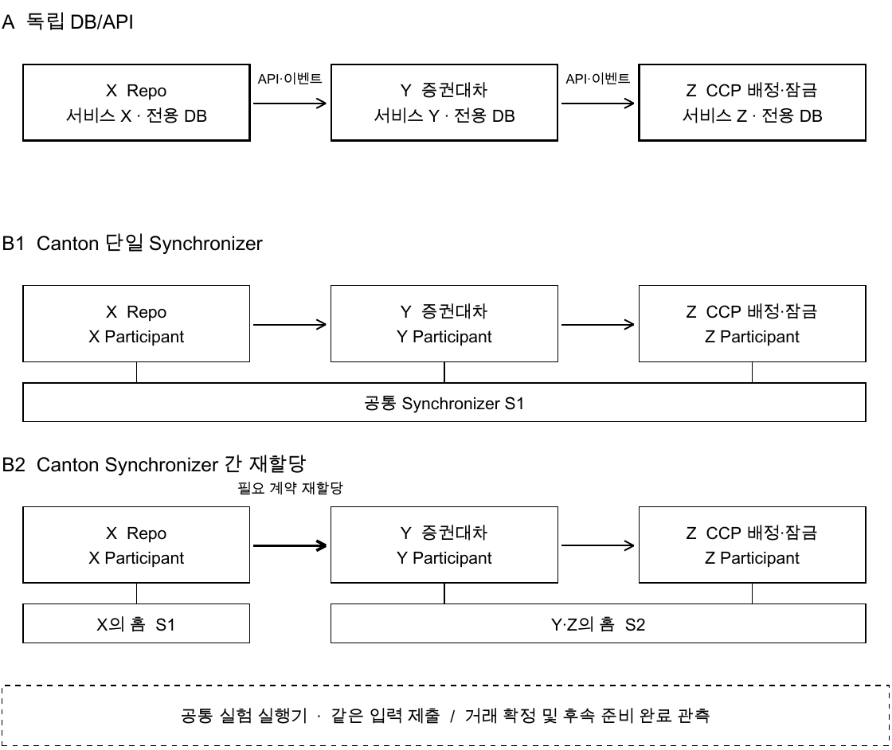

# 기관 간 국채 담보 이동성 PoC

## 연구 개요

HYBLOCK의 기관 간 국채 담보 이동성 개념검증(PoC) 프로젝트. 동일한 국채 묶음을 **Repo(환매조건부매매) → 증권대차 → CCP(중앙청산소) 증거금 배정**에 연속 활용하는 업무를 독립 DB/API와 Canton으로 구현하고, 처리 지연·상태 정합성·장애 대응·플랫폼 연계의 차이를 비교하였다.

**주요 결과.** 독립 DB/API의 정상 흐름 완료시간이 더 짧았다. Canton은 CCP 배정과 담보 사용권 잠금을 한 원장 거래로 확정하여, 이번 독립 DB/API 구현에서 애플리케이션이 맡았던 상태 조정의 일부를 원장 거래로 이전하였다.

[최종 연구 보고서 (PDF)](docs/report.pdf) · [공개 실험 데이터](docs/evidence/)

## 비교 설계

| 모델 | 구현 | 비교 목적 |
| --- | --- | --- |
| **A · 독립 DB/API** | X(Repo), Y(증권대차), Z(CCP 배정)가 각자 DB를 운영하고 API로 연계 | 분리된 시스템 간 권리·상태 조정의 기준 모델 |
| **B1 · Canton, 공통 Synchronizer** | X·Y·Z의 Participant가 하나의 Synchronizer에서 거래를 조율 | 공통 원장에서의 거래 처리와 상태 조정 방식 비교 |
| **B2 · Canton, Synchronizer 간 재할당** | X 이후 필요한 계약을 S1에서 S2로 재할당하고 Y·Z 진행 | 계약 재할당 지연 및 사용 불가 구간 측정 |

세 모델에 동일한 업무 조건을 적용하였다. 거래 합의와 담보 적격성·재사용 규칙은 사전에 확정된 조건으로 두었으며, 후속 업무가 가능해지면 실행기가 자동으로 요청을 제출하였다. 비교 범위는 **담보 사용권과 배정 상태의 변화**로 한정하였다. 실제 증권 인도, 현금 결제, 외부 수탁·결제기관 확인 및 수동 승인은 실험 범위에서 제외하였다.

## 실험 결과

| 지표 | A | B1 | B2 |
| --- | ---: | ---: | ---: |
| **연속 활용 지연 P50 / P95** | **52.8 / 83.1ms** | **1,114.4 / 1,318.8ms** | **1,736.6 / 1,917.5ms** |
| **경합 검증 통과 / 관측된 이중 사용·배정** | 30/30 · 0건 | 30/30 · 0건 | — |
| **Y 응답 지연 후 결과 확인 P50** | 5.12초 | 5.40초 | — |
| **계약 재할당 / 계약 사용 불가 P50** | — | — | 694.4 / 397.9ms |

- **정상 흐름:** X 확정 최초 관측부터 Z 확정 최초 관측까지의 시간을 모델별 유효 본 시도 30건으로 집계하였다. B2의 측정값에는 재할당 구간이 포함된다.
- **응답 지연:** 모델별 5회 실시하였다. Y의 첫 응답이 지연된 상황에서 A와 B1 모두 원래 요청의 확정 결과와 업무 상태를 확인하였다. 결과 확인 시간에는 5초 HTTP 타임아웃이 포함된다.
- **검증 범위:** 최종 공통 검증 A·B1 각 71건, B2 34건 통과. 계측 실험은 워밍업을 포함해 T1 66회, T2 60회, T3 10회, T4 33회로 총 169회 실시하였다.

## 플랫폼 연계 분석

| 구분 | A · 독립 DB/API | B1 · Canton |
| --- | --- | --- |
| **CCP 플랫폼 연결** | Y에 담보 사용권 조회·잠금 API 2개 추가 | Z Participant 연결, 기관 권한 설정, Daml 계약 배포 |
| **잠금과 배정의 확정** | Y가 잠금 결정을 기록하고 Z가 그 결정에 따라 배정을 확정 | 공통 Synchronizer의 조율 아래 잠금과 배정을 하나의 원장 거래로 확정 |
| **응답 유실 시 확인** | Y 잠금 응답이 유실되면 Z가 원래 잠금 결정을 확인한 뒤 배정을 완료 | 잠금과 배정의 확정 결과를 해당 원장 거래 단위로 확인 |

B1은 Y의 잠금 결정과 Z의 배정 상태를 맞추는 별도 업무 경로를 줄였다. 비교한 세 모델에서 Repo, 증권대차, CCP 배정은 각각 별도 거래로 처리하였다.

## 해석 범위

지연값은 A의 Docker 환경과 B1·B2의 네이티브 Canton 환경에서 관측한 값이다. 본 실험은 독립 DB/API 구현과 Canton 구현을 비교하였으며, 공동 확정을 지원하는 분산 DB 방식은 비교 대상에 포함하지 않았다. 실제 기관에서 절감되는 운영·대사 비용과 제도·운영 제약이 담보 이동성에 미치는 영향은 후속 검증 과제다.

## 연구팀

| 이름 | 역할 | 주요 담당 |
| --- | --- | --- |
| **이서진** | 연구·실험 총괄 | 연구 및 실험 설계, 공통 명세·데이터, 실행기·계측, 결과 분석과 보고 |
| **연수인** | Model A 구현 | 독립 DB/API, 담보 업무 처리, 권한·경합·복구 및 모델 자체 검증 |
| **마양하** | Model B1·B2 구현 | Canton Participant·Daml 계약, 단일 Synchronizer 업무 처리, S1→S2 재할당 및 모델 자체 검증 |

## 코드와 재현 기준

- **공통 실험 기준:** [`4d9369c` · PR #14 병합본](https://github.com/HYBLOCK-LAB/collateral-mobility-poc/tree/4d9369c59ad4e2f60b03483caeca07a3b2246a6b)
- **공통 규칙:** [업무 명세](spec/business.md) · [인터페이스](spec/interface.md) · [인수 기준](spec/acceptance.md) · [계측 명세](spec/measurement.md) · [Schema·fixture](shared/)
- **구현·실행:** [A DB/API](implementations/db-api/README.md) · [B1/B2 Canton](implementations/canton/README.md) · [공통 실행기](tests/conformance/README.md)
- **개발 당시 팀 가이드:** [실험 기준 커밋의 README](https://github.com/HYBLOCK-LAB/collateral-mobility-poc/blob/4d9369c59ad4e2f60b03483caeca07a3b2246a6b/README.md)

| 계측 배치 | 원본 배치 ID |
| --- | --- |
| T1 · 정상 흐름 | `batch-24f8f3b65f374c0cb4f40802c9f52792` |
| T2 · 경합 | `batch-e633078366c0465bab42ed4d1e8197b6` |
| T3 · Y 응답 지연·복구 | `batch-e5edaa44a6544fadab98c5dd3a87b044` |
| T4 · B2 계약 재할당 | `batch-48edd462d3e345759d28470f7f0420f6` |

배치 ID는 실측 원본을 식별한다. `shared/fixtures/`는 재현용 입력 데이터이며, 실행 로그와 실측 결과는 별도로 보관한다.
